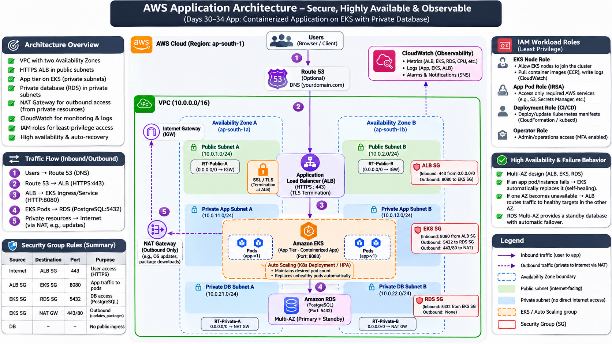
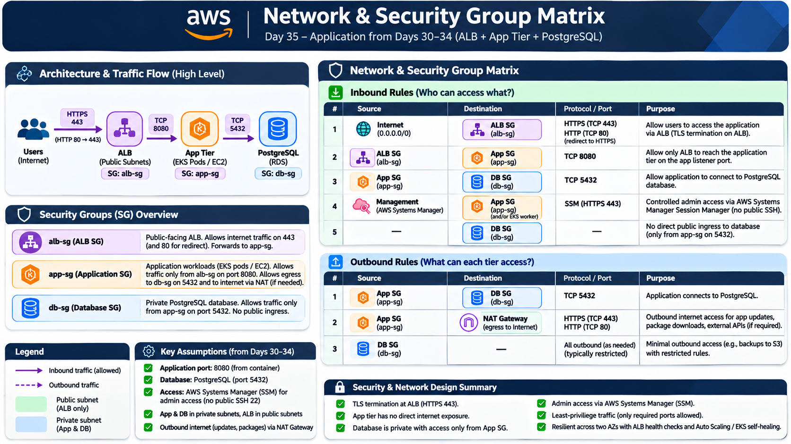
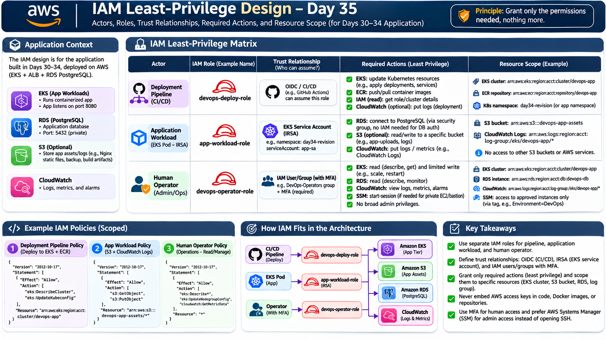
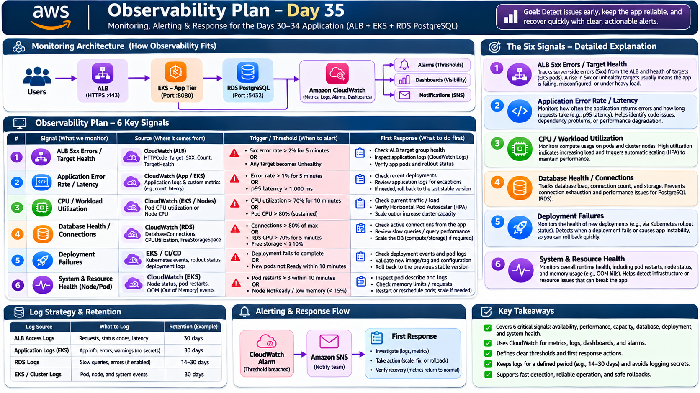

# Day 35 – AWS Architecture & Security Design Lab

## Lab Overview

The objective of Day 35 is to design a secure, highly available, observable, and cost-aware AWS architecture for the application developed during Days 30–34.

During the previous days, I worked with Linux, Docker, Docker Compose, and Kubernetes using Minikube. In Day 35, I translate that application architecture into a proposed AWS cloud architecture.

The main focus of this lab is:

- AWS architecture design.
- VPC and subnet networking.
- Security Groups and network traffic control.
- IAM least-privilege access.
- Application availability and resilience.
- CloudWatch monitoring and observability.
- Cost-aware architecture decisions.
- Optional AWS Console validation and LocalStack practice.

**Important:** This is a design-first lab. Deploying AWS resources is not required. All required tasks can be completed without launching paid AWS resources.

---

## Application Architecture Context (Days 30–34)

The application developed during Days 30–34 is a containerized application.

The application was first developed and tested in a Linux environment, containerized using Docker, managed using Docker Compose, and deployed locally using Kubernetes with Minikube.

For the proposed AWS architecture, I selected:

**Option B – Application Load Balancer + Amazon EKS + Amazon RDS PostgreSQL.**

The proposed application architecture uses:

| Component | AWS Service | Purpose |
|---|---|---|
| DNS | Amazon Route 53 | Domain name resolution |
| Load Balancer | Application Load Balancer | Distributes incoming HTTPS traffic |
| Container Orchestration | Amazon EKS | Runs and manages application containers |
| Database | Amazon RDS PostgreSQL | Stores application data |
| Networking | Amazon VPC | Provides isolated cloud networking |
| Monitoring | Amazon CloudWatch | Collects metrics, logs, and alarms |
| Identity and Access | AWS IAM | Provides controlled access to AWS resources |
| Outbound Connectivity | NAT Gateway | Allows private resources to access the internet when required |

### Application Ports

| Component | Port | Purpose |
|---|---:|---|
| ALB | 443 | HTTPS user access |
| Application | 8080 | Application traffic |
| PostgreSQL | 5432 | Database communication |

The application port is assumed to be 8080, based on the proposed architecture. It must match the actual container listening port used in Days 30–34.

---

# Task 1 – Draw the Target Architecture

## Objective

Design a one-page AWS architecture diagram showing how the application will be hosted securely and reliably in AWS.

The architecture contains:

- Users accessing the application.
- Optional Route 53 for DNS.
- HTTPS Application Load Balancer in public subnets.
- Amazon EKS application workloads in private subnets.
- Amazon RDS PostgreSQL in private database subnets.
- VPC distributed across two Availability Zones.
- Internet Gateway and route tables.
- NAT Gateway for required outbound connectivity.
- CloudWatch monitoring.
- IAM workload roles.

## AWS Architecture Diagram



**Image filename:** `Architecture.png`

## Architecture Explanation

### 1. Users and Route 53

Users access the application through a browser.

Amazon Route 53 can optionally provide DNS resolution for a custom domain name.

Example:

```text
https://myapplication.example.com
```

Route 53 directs users to the Application Load Balancer.

### 2. Application Load Balancer

The Application Load Balancer receives incoming HTTPS traffic on port 443.

It is deployed across public subnets in two Availability Zones.

TLS termination takes place at the ALB, allowing HTTPS traffic to be handled securely.

The ALB forwards application traffic to the EKS application tier.

### 3. Amazon EKS Application Tier

Amazon EKS manages the containerized application.

The application runs inside Kubernetes Pods in private application subnets.

EKS provides:

- Container orchestration.
- Deployment management.
- Pod scaling.
- Rolling updates.
- Rollbacks.
- Workload recovery.

The application is not directly exposed to the public internet.

### 4. Amazon RDS PostgreSQL

Amazon RDS PostgreSQL provides the database service.

The database is deployed in private database subnets.

Only the application tier is permitted to connect to PostgreSQL on port 5432.

The database does not allow direct public access.

For higher availability, a Multi-AZ database configuration can be selected.

### 5. VPC and Availability Zones

The architecture uses one VPC distributed across two Availability Zones.

Each Availability Zone contains public and private subnet boundaries.

Public subnets host the internet-facing ALB.

Private application subnets host the EKS workloads.

Private database subnets host the database tier.

This separation reduces direct internet exposure and improves resilience.

### 6. Internet Gateway and NAT Gateway

The Internet Gateway provides internet connectivity for public-subnet resources.

The NAT Gateway allows private resources to initiate outbound internet connections when required, such as downloading updates or accessing external services.

NAT Gateways are not required for every private workload. VPC endpoints or other private connectivity options may be more suitable for AWS service access.

### 7. CloudWatch

Amazon CloudWatch collects infrastructure and application monitoring information.

It can monitor:

- ALB metrics.
- EKS and workload metrics.
- Application logs.
- Database metrics.
- CPU utilization.
- Errors and latency.
- Alarms and notifications.

### 8. IAM Workload Roles

IAM roles provide controlled access to AWS resources.

The application workload receives only the permissions it needs.

AWS access keys should never be embedded in application code, Docker images, or Git repositories.

---

# Task 2 – Network and Security Group Matrix

## Objective

Define which components can communicate with each other, which ports are allowed, and why the communication is required.

Security Groups act as virtual firewalls for AWS resources.

They control inbound and outbound network traffic.

## Network and Security Group Visualization



**Image filename:** `Network&SecurityGroupMatrix.png`

## Security Group Design

Three main Security Groups are used in the proposed architecture.

### 1. ALB Security Group – alb-sg

Purpose: Controls incoming internet traffic to the Application Load Balancer.

Inbound rules:

| Source | Protocol | Port | Purpose |
|---|---|---:|---|
| Internet (0.0.0.0/0) | TCP | 443 | HTTPS application access |
| Internet (0.0.0.0/0) | TCP | 80 | Optional redirect to HTTPS |

Outbound traffic is allowed to the application Security Group on port 8080.

### 2. Application Security Group – app-sg

Purpose: Protects the application workloads.

Inbound rules:

| Source | Protocol | Port | Purpose |
|---|---|---:|---|
| ALB Security Group | TCP | 8080 | Allow ALB to reach application workloads |

Outbound rules:

| Destination | Protocol | Port | Purpose |
|---|---|---:|---|
| Database Security Group | TCP | 5432 | PostgreSQL connectivity |
| NAT Gateway | TCP | 443/80 | Required outbound internet access |

### 3. Database Security Group – db-sg

Purpose: Protects the PostgreSQL database.

Inbound rule:

| Source | Protocol | Port | Purpose |
|---|---|---:|---|
| Application Security Group | TCP | 5432 | Application database connectivity |

The database must not accept direct public internet traffic.

## Overall Traffic Flow

```text
Internet
   |
   | HTTPS 443
   v
ALB Security Group
   |
   | TCP 8080
   v
Application Security Group
   |
   | TCP 5432
   v
Database Security Group
   |
   v
RDS PostgreSQL
```

## Administrative Access

For administration, AWS Systems Manager Session Manager is preferred over exposing SSH port 22 to the public internet.

This provides a controlled administrative access path without requiring a publicly accessible SSH port.

**Key Learning:** Each application tier should communicate only with the resources and ports it actually requires.

---

# Task 3 – IAM Least-Privilege Exercise

## Objective

Design IAM roles for different actors in the application architecture.

The principle of least privilege means granting only the permissions required to perform a specific task.

The architecture uses three main actors:

1. Deployment Pipeline.
2. Application Workload.
3. Human Operator.

## IAM Least-Privilege Visualization



**Image filename:** `IAMLeast-PrivilegeDesign.png`

## 1. Deployment Pipeline Role

Example role name:

```text
devops-deploy-role
```

Purpose:

Allows the CI/CD deployment pipeline to deploy the application.

Trust relationship:

The role can be assumed by an approved CI/CD identity through OIDC federation.

Required actions may include:

- Update approved Kubernetes deployment resources.
- Deploy application versions.
- Retrieve EKS cluster connection information.
- Push application images to the approved ECR repository, if required.
- Read relevant deployment information.

Resource scope:

- Specific EKS cluster.
- Specific ECR repository.
- Specific Kubernetes namespace, where supported by the access design.

The deployment pipeline should not receive unrestricted Administrator access.

## 2. Application Workload Role

Example role name:

```text
app-workload-role
```

Purpose:

Allows the application running inside EKS to access specific AWS services when required.

Trust relationship:

An EKS workload identity, such as IAM Roles for Service Accounts (IRSA), can assume the role through its Kubernetes service account.

Required actions depend on the application's actual needs.

Examples:

- Read application assets from a specific S3 bucket.
- Write application logs to CloudWatch.
- Retrieve specific secrets from AWS Secrets Manager, if needed.

Resource scope:

Only the required S3 bucket, log group, or secret resources.

Important:

The application does not need AWS permissions merely to connect to PostgreSQL through its network Security Group.

Database authentication should be handled separately through approved database credentials or an appropriate managed authentication method.

Never store AWS access keys in:

- Application source code.
- Docker images.
- Git repositories.
- Configuration files committed to Git.

## 3. Human Operator Role

Example role name:

```text
devops-operator-role
```

Purpose:

Allows authorized administrators or DevOps engineers to inspect and operate the AWS environment.

Trust relationship:

An authorized IAM Identity Center user or approved IAM identity assumes the role.

MFA should be enabled where applicable.

Required actions:

- Inspect EKS cluster status.
- Review application deployments.
- Inspect CloudWatch metrics and logs.
- Review RDS health.
- Use approved Systems Manager access for administration where required.

Resource scope:

Only the specific application infrastructure and operational resources.

## IAM Design Summary

| Actor | Role | Trust relationship | Access |
|---|---|---|---|
| CI/CD Pipeline | devops-deploy-role | OIDC identity | Application deployment |
| EKS Application | app-workload-role | EKS service account / IRSA | Required AWS services |
| Human Operator | devops-operator-role | Authorized user/group | Approved operations with MFA |

**Key Learning:** Separate IAM roles provide better security and make it easier to control and audit AWS access.

---

# Task 4 – Resilience and Traffic Flow

## Objective

Explain how the architecture handles failures and maintains application availability.

### 1. ALB Health Checks

The Application Load Balancer periodically checks the health of registered targets.

An example health-check path is:

```text
/health
```

The application must actually implement this endpoint.

If a target becomes unhealthy, the ALB stops sending normal traffic to that target.

### 2. Application Recovery

EKS manages application workloads.

If an application Pod fails, Kubernetes can create a replacement to maintain the desired number of replicas.

If the underlying worker-node capacity fails, the cluster needs sufficient healthy capacity or an appropriate node-recovery/scaling mechanism to run replacement Pods.

### 3. Availability Zone Failure

The architecture distributes application resources across two Availability Zones.

If one AZ becomes unavailable:

- The ALB can continue routing to healthy targets in the other AZ.
- EKS workloads should have sufficient capacity in the surviving AZ.
- The database availability configuration determines how database recovery works.

### 4. Database Availability

A Multi-AZ RDS configuration provides higher database availability than a single-AZ configuration.

A standby or supported Multi-AZ deployment can provide failover capability.

The additional availability comes with additional cost.

### 5. Safe Deployment and Rollback

Application updates should use a controlled deployment process.

Recommended steps:

1. Build and test the new Docker image.
2. Deploy the new version to EKS.
3. Monitor rollout status and application health.
4. Check ALB target health and CloudWatch metrics.
5. Roll back to the previous stable version if the new release causes problems.

Useful Kubernetes commands:

```bash
kubectl rollout status deployment/revision-app
```

```bash
kubectl rollout history deployment/revision-app
```

```bash
kubectl rollout undo deployment/revision-app
```

**Key Learning:** High availability requires more than multiple Pods. The network, compute capacity, load balancer, and database must all be designed to tolerate failures.

---

# Task 5 – Observability Plan

## Objective

Create a monitoring plan that helps detect application problems early and respond to them effectively.

Amazon CloudWatch is the main monitoring service in the proposed architecture.

The monitoring plan contains six important signals.

## Observability Plan Visualization



**Image filename:** `ObservabilityPlan.png`

## Signal 1 – ALB 5xx Errors and Target Health

Source:

Amazon CloudWatch ALB metrics.

What to monitor:

- HTTP 5xx response count.
- Target health.
- Unhealthy targets.

Example alert condition:

- 5xx error rate greater than 2% for five minutes.
- Any application target becomes unhealthy.

First response:

1. Inspect ALB target group health.
2. Check application logs.
3. Verify Pod or instance health.
4. Inspect recent deployments.

Purpose:

Detects application availability problems and failures between the load balancer and application tier.

## Signal 2 – Application Error Rate and Latency

Source:

Application logs and application performance metrics.

What to monitor:

- Application error rate.
- Request latency.
- Response time.
- p95 latency.

Example alert condition:

- Application error rate greater than 1% for five minutes.
- p95 latency exceeds 1,000 milliseconds.

First response:

1. Check recent application deployments.
2. Review application logs.
3. Inspect dependency failures.
4. Roll back if a recent deployment caused the issue.

Purpose:

Detects application errors and performance degradation.

## Signal 3 – CPU and Workload Utilization

Source:

CloudWatch EKS/node metrics and suitable container monitoring.

What to monitor:

- Pod CPU utilization.
- Node CPU utilization.
- Memory utilization.
- Workload scaling.

Example alert condition:

- CPU utilization greater than 70% for ten minutes.
- Pod CPU usage remains above the expected capacity.

First response:

1. Inspect workload traffic.
2. Check resource requests and limits.
3. Review Horizontal Pod Autoscaler behavior.
4. Scale workloads or cluster capacity if needed.

Purpose:

Helps identify resource pressure and scaling requirements.

## Signal 4 – Database Health and Connections

Source:

Amazon CloudWatch RDS metrics.

What to monitor:

- Database connections.
- CPU utilization.
- Free storage space.
- Database health.

Example alert condition:

- Connections exceed 80% of the configured maximum.
- Database CPU remains above 70%.
- Free storage becomes critically low.

First response:

1. Inspect active database connections.
2. Check application connection usage.
3. Review slow queries.
4. Investigate database capacity.

Purpose:

Prevents database connection exhaustion and performance problems.

## Signal 5 – Deployment Failures

Source:

EKS deployment events, Kubernetes rollout status, and CI/CD logs.

What to monitor:

- Failed deployments.
- Pods that fail to become Ready.
- Rollout failures.
- Image and configuration errors.

Example alert condition:

- Deployment fails to complete.
- New Pods do not become Ready within ten minutes.

First response:

1. Inspect Kubernetes events.
2. Check Pod logs.
3. Verify the image and configuration.
4. Roll back to the previous stable version if necessary.

Purpose:

Detects release problems before they affect application availability.

## Signal 6 – System and Resource Health

Source:

CloudWatch EKS/node metrics and Kubernetes events.

What to monitor:

- Pod restarts.
- Node readiness.
- Memory utilization.
- Out-of-memory events.
- Workload availability.

Example alert condition:

- More than three Pod restarts within ten minutes.
- A node becomes NotReady.
- Available memory falls below the defined threshold.

First response:

1. Inspect Pod descriptions and logs.
2. Check memory requests and limits.
3. Investigate OOMKilled events.
4. Restart or reschedule workloads where appropriate.
5. Add capacity if required.

Purpose:

Detects infrastructure and resource issues that can affect application stability.

## Log Strategy and Retention

| Log source | Information collected | Example retention |
|---|---|---|
| ALB Access Logs | Requests, status codes, latency | 30 days |
| Application Logs | Application events and errors | 30 days |
| RDS Logs | Database errors and slow queries | 14–30 days |
| EKS/Cluster Logs | Pod, node, and system events | 30 days |

These retention periods are proposed design assumptions, not mandatory AWS defaults.

Sensitive information must never be included in application or infrastructure logs.

Never log:

- AWS access keys.
- Passwords.
- Authentication tokens.
- Database credentials.
- Sensitive user information.

## Alerting and Response Flow

```text
AWS Resources
     |
     v
CloudWatch Metrics and Logs
     |
     v
CloudWatch Alarms
     |
     v
Amazon SNS Notifications
     |
     v
DevOps Engineer
     |
     v
Investigate -> Fix -> Verify Recovery
```

**Key Learning:** Monitoring is useful only when alerts have clear thresholds and actionable response procedures.

---

# Task 6 – Cost-Aware Architecture Decision

## Objective

Compare two possible AWS architectures and select the one most suitable for the application.

The PDF provides two options:

- Option A: ALB + EC2 Auto Scaling Group + Private Database.
- Option B: ALB + EKS Workload + Private Database.

## Architecture Options

### Option A – ALB + EC2 Auto Scaling Group + RDS

The application runs directly on EC2 instances.

The EC2 Auto Scaling Group maintains the desired number of application instances.

Advantages:

- Simpler infrastructure.
- Lower operational complexity for a small application.
- No EKS control-plane charge.
- Familiar EC2 administration.

Disadvantages:

- Requires operating system management.
- Requires instance configuration and patching.
- Less container-native orchestration.
- Application deployment and scaling need additional configuration.

### Option B – ALB + Amazon EKS + RDS PostgreSQL

The application runs as containers managed by Kubernetes on Amazon EKS.

Advantages:

- Container-native architecture.
- Kubernetes deployment management.
- Rolling updates and rollbacks.
- Pod-level scaling.
- Better alignment with the Days 30–34 Docker and Kubernetes work.
- Suitable for applications that may grow into multiple services.

Disadvantages:

- Higher infrastructure complexity.
- Requires Kubernetes operational knowledge.
- EKS control-plane charges.
- Worker-node compute charges.
- Additional monitoring and maintenance requirements.

## Selected Architecture: Option B

For this application, I selected **Option B – ALB + Amazon EKS + Amazon RDS PostgreSQL**.

The main reason is that the application was already containerized with Docker and deployed locally using Minikube during Days 30–34.

EKS provides a natural path from local Kubernetes practice to a managed Kubernetes environment in AWS.

It supports:

- Container orchestration.
- Deployment and rollout management.
- Application scaling.
- Workload isolation.
- Kubernetes-based operations.
- Future application growth.

However, EKS is not automatically the cheapest option.

For a small application with only one simple service and limited traffic, Option A may be more economical and easier to operate.

Option B is selected because of the application's containerized development path and the goal of gaining practical Kubernetes experience, rather than because it has the lowest cost.

## Cost Drivers for Option B

The selected architecture has several potential AWS charge sources.

| AWS Component | Cost Driver | Why It Can Cost Money |
|---|---|---|
| Application Load Balancer | Hourly usage and processed data | Handles incoming application traffic |
| Amazon EKS | Cluster control-plane charge | Provides managed Kubernetes control plane |
| EC2 Worker Nodes | Instance runtime and compute | Runs application Pods |
| NAT Gateway | Hourly charge and data processing | Provides outbound internet connectivity |
| Amazon RDS | Database instance and storage | Hosts PostgreSQL |
| EBS / Storage | Provisioned storage and usage | Stores persistent data and workload volumes |
| Data Transfer | Network traffic | Transfers data between services and networks |
| CloudWatch | Metrics, logs, and alarms | Collects and stores monitoring data |

## Cost Optimization Strategies

### 1. Use the Right Compute Capacity

Choose worker-node sizes based on actual application requirements.

Avoid running unnecessarily large EC2 instances.

### 2. Scale Workloads

Use Kubernetes resource requests, limits, and Horizontal Pod Autoscaler where appropriate.

Avoid allocating excessive CPU and memory.

### 3. Avoid Unnecessary NAT Gateways

NAT Gateways can be a significant recurring cost.

Use them only when private resources genuinely require outbound internet access.

Consider VPC endpoints for suitable AWS services.

### 4. Choose Database Capacity Carefully

Select an RDS instance size appropriate for the application.

For a production high-availability requirement, consider Multi-AZ while accounting for its higher cost.

### 5. Monitor CloudWatch Usage

Set suitable log retention periods.

Avoid unnecessary high-volume logging and excessive metric collection.

### 6. Delete Unused Resources

Remove test infrastructure after approved exercises.

Check for leftover storage, load balancers, NAT Gateways, databases, and other billable resources.

## Important AWS Free Tier Consideration

AWS Free Tier does not mean that every AWS service or configuration is free.

EKS, ALB, NAT Gateway, RDS, compute, storage, and data transfer may generate charges depending on the configuration, region, account eligibility, and usage.

Therefore, the selected architecture is a proposed design. It does not mean these resources have been deployed.

Use the AWS Pricing Calculator before estimating or approving deployment costs:

https://calculator.aws/

**Key Learning:** The best architecture is not necessarily the cheapest architecture. It should balance security, availability, complexity, scalability, and cost.

---

# Task 7 – Optional AWS Console Validation and LocalStack

## Objective

Validate the proposed AWS architecture by inspecting AWS configuration and understanding what each setting accomplishes.

This task is optional.

It is possible to complete it without creating paid AWS resources.

I use an AWS Free Tier account and LocalStack for local AWS service practice.

## 1. AWS Console Validation

Open the AWS Management Console:

https://console.aws.amazon.com/

Select the intended AWS region and inspect existing resources in read-only mode.

### A. VPC and Subnets

Navigate to:

```text
AWS Console -> VPC -> Your VPCs
```

Inspect:

- VPC CIDR range.
- Public subnets.
- Private subnets.
- Availability Zones.

Then open:

```text
VPC -> Route Tables
```

Check the routing configuration.

Expected design:

- Public subnet default route points to the Internet Gateway.
- Private application subnet has NAT or appropriate private service connectivity when needed.
- Private database subnet has no direct internet route.

### B. Security Groups

Navigate to:

```text
AWS Console -> EC2 -> Network & Security -> Security Groups
```

Inspect:

- ALB Security Group.
- Application Security Group.
- Database Security Group.

Verify the expected traffic:

| Security Group | Expected Inbound Access |
|---|---|
| alb-sg | HTTPS 443 from internet |
| app-sg | TCP 8080 from alb-sg |
| db-sg | TCP 5432 from app-sg |

The database must not have direct public ingress.

### C. IAM Roles

Navigate to:

```text
AWS Console -> IAM -> Roles
```

Inspect existing roles and review:

- Role name.
- Trust relationship.
- Attached permissions.
- Resource scope.

Compare them with the Day 35 IAM design.

### D. Application Load Balancer

Navigate to:

```text
AWS Console -> EC2 -> Load Balancers
```

If an ALB already exists, inspect:

- Load balancer scheme.
- Listeners.
- HTTPS certificate.
- Target groups.
- Health-check path.
- Target health.

Expected design:

```text
HTTPS Listener: 443
Application Port: 8080
Health Check: /health
```

The `/health` endpoint must exist in the application before it is used.

### E. CloudWatch

Navigate to:

```text
AWS Console -> CloudWatch
```

Inspect:

- Metrics.
- Log groups.
- Alarms.
- Dashboards.

Compare the available monitoring configuration with the six signals documented in Task 5.

Do not create resources simply to make the console look populated.


## 2. Cost and Cleanup Precautions

Before creating any real AWS resources:

1. Verify account eligibility and available budget.
2. Check the current pricing for the selected region.
3. Prepare a cleanup plan.
4. Obtain permission before creating resources.
5. Delete approved test resources after validation.
6. Check for remaining resources that may generate charges.

Stopping an EC2 instance does not necessarily stop every related charge. Storage, networking, and other resources may continue generating costs.

Never expose AWS account IDs, credentials, access keys, or billing details in screenshots.

**My approach:** Use the AWS Console for read-only inspection and LocalStack for supported local exercises. Document unavailable services instead of deploying expensive resources.

---

# Key Learnings

After completing Day 35, I understand how to:

- Design a secure AWS architecture for a containerized application.
- Organize resources using VPCs, public subnets, and private subnets.
- Design a two-AZ architecture for higher availability.
- Route HTTPS traffic through an Application Load Balancer.
- Use Amazon EKS for container orchestration.
- Connect application workloads to private RDS PostgreSQL.
- Apply least-privilege Security Group rules.
- Design IAM roles for CI/CD, application workloads, and operators.
- Understand IAM trust relationships and resource scope.
- Plan application recovery and safe deployment rollbacks.
- Design CloudWatch monitoring using six important signals.
- Compare EC2 Auto Scaling and EKS architectures.
- Identify AWS cost drivers and optimization opportunities.
- Inspect AWS infrastructure safely.
- Practise supported AWS service operations locally using LocalStack.

---

# Interview Questions

## 1. What is the purpose of an AWS VPC?

A VPC is a logically isolated virtual network where AWS resources can be launched and connected securely.

## 2. What is the difference between public and private subnets?

A public subnet has a route to an Internet Gateway. A private subnet does not have direct internet routing through an Internet Gateway.

## 3. Why should application servers be placed in private subnets?

Private subnets reduce direct internet exposure. Application traffic can be accepted only from approved sources such as the ALB.

## 4. What is an Application Load Balancer?

An ALB distributes incoming application traffic across healthy targets and supports HTTP and HTTPS traffic.

## 5. Why do we use HTTPS port 443?

HTTPS encrypts communication between users and the application endpoint using TLS.

## 6. What is the purpose of a NAT Gateway?

A NAT Gateway allows resources in private subnets to initiate outbound internet connections without allowing unsolicited inbound internet connections.

## 7. What is the difference between Security Groups and Network ACLs?

Security Groups are stateful virtual firewalls associated with network interfaces. Network ACLs are stateless filters applied at the subnet level.

## 8. What is IAM least privilege?

It means granting an identity only the permissions required to perform its specific tasks.

## 9. Why should we use IAM roles instead of hard-coded access keys?

IAM roles provide temporary credentials and reduce the risk of exposing long-term credentials in application code or repositories.

## 10. What is IRSA in Amazon EKS?

IAM Roles for Service Accounts allows Kubernetes workloads to obtain AWS permissions through associated IAM roles rather than sharing broad node permissions.

## 11. What is the purpose of an RDS Multi-AZ deployment?

It improves database availability by providing a standby or supported Multi-AZ deployment configuration and failover capability.

## 12. What is the difference between EC2 Auto Scaling and EKS?

EC2 Auto Scaling adjusts the number of EC2 instances. EKS manages Kubernetes workloads and their orchestration, while compute capacity must also be managed.

## 13. What happens when an ALB target becomes unhealthy?

The ALB stops routing normal traffic to that unhealthy target until it becomes healthy again.

## 14. What is Amazon CloudWatch?

CloudWatch is an AWS monitoring and observability service used to collect metrics, logs, and alarms.

## 15. What are the six signals in our observability plan?

1. ALB 5xx errors and target health.
2. Application error rate and latency.
3. CPU and workload utilization.
4. Database health and connections.
5. Deployment failures.
6. System and resource health.

## 16. What is the difference between Multi-AZ and Multi-Region?

Multi-AZ improves resilience against an Availability Zone failure. Multi-Region can help protect against regional failures but adds complexity and cost.

## 17. Why did we select Option B for this application?

Option B uses ALB, EKS, and RDS PostgreSQL. It aligns with the Docker and Kubernetes work completed during Days 30–34 and supports container orchestration, deployment management, scaling, and future growth.

## 18. Is EKS always cheaper than EC2 Auto Scaling?

No. EKS has additional control-plane and operational costs. EC2 Auto Scaling may be more economical for a small, simple application.

## 19. What are the major cost drivers in our selected architecture?

- ALB.
- EKS control plane.
- EC2 worker nodes.
- NAT Gateway.
- RDS instance and storage.
- EBS storage.
- Data transfer.
- CloudWatch usage.

## 20. What is LocalStack?

LocalStack is a local AWS cloud emulator that allows developers to practise supported AWS service operations without creating equivalent resources in a real AWS account.

## 21. Why should we avoid exposing SSH port 22 to the internet?

Exposing SSH broadly increases the attack surface. Controlled access through Systems Manager Session Manager is a safer administrative approach where supported and configured.

## 22. Why is cost awareness important in cloud architecture?

Cloud services can generate charges based on runtime, storage, requests, and data transfer. Cost-aware design helps avoid unnecessary spending while meeting application requirements.

---

**Day 35 – AWS Architecture & Security Design Lab**

**Selected Architecture:** Option B – Application Load Balancer + Amazon EKS + Amazon RDS PostgreSQL.

**Main Focus:** Security, high availability, least privilege, observability, resilience, and cost-aware cloud architecture.
